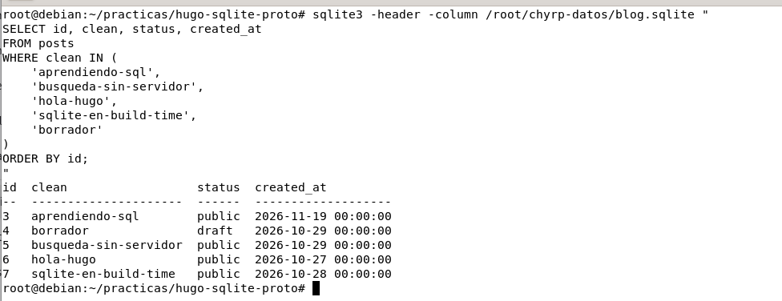
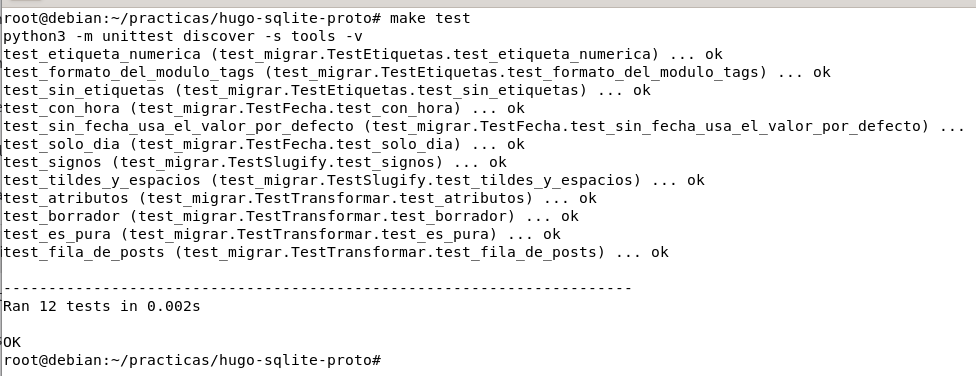
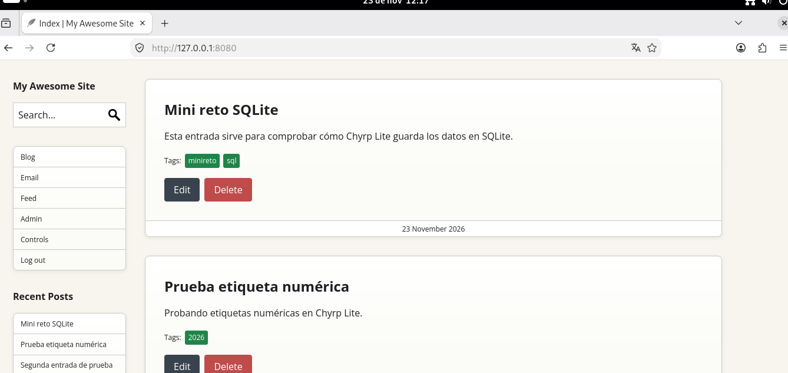
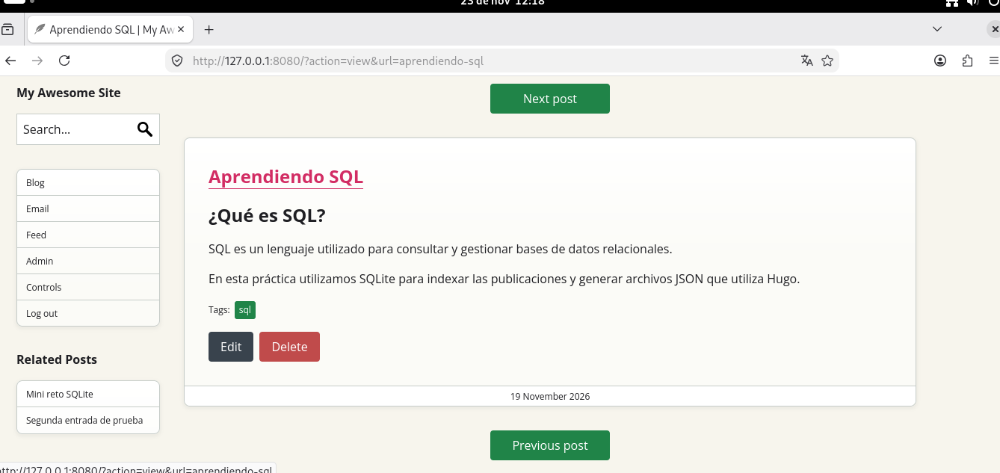

P1.2 — Migración de Hugo + SQLite a Chyrp Lite + SQLite

1. Objetivo

El objetivo de esta práctica es migrar las entradas de un blog estático creado con Hugo a Chyrp Lite, utilizando SQLite como sistema de gestión de bases de datos.

También se estudian las diferencias entre utilizar SQLite durante la generación de una web estática y utilizarlo durante el funcionamiento de una aplicación dinámica.

2. Instalación y estructura de la base de datos

Se instaló Chyrp Lite en Debian y se configuró una base de datos SQLite.

Rutas utilizadas:

Aplicación: /root/chyrp

Base de datos: /root/chyrp-datos/blog.sqlite

Proyecto Hugo: /root/practicas/hugo-sqlite-proto

En Chyrp Lite, la tabla posts almacena los datos generales de las entradas, mientras que post_attributes almacena atributos como el título, el contenido y las etiquetas.

En el prototipo Hugo, la información estaba distribuida entre las tablas posts, tags y words.

3. Migración de las entradas

Se utilizó el script tools/migrar.py para transformar las entradas Markdown de Hugo al formato de Chyrp Lite.

Se migraron cinco entradas, incluyendo un borrador.

Primero se realizó una simulación y después la migración real sobre una copia de la base de datos.

Al ejecutar de nuevo el migrador, se comprobó que las cinco entradas ya existían y no se insertaron duplicados.

Esto demuestra que la migración es idempotente.

4. Pruebas automáticas

Las pruebas se ejecutaron mediante:

make test

Resultado final:

Ran 12 tests in 0.001s

OK

Las pruebas comprueban el tratamiento de fechas, etiquetas, identificadores y transformación de entradas.

5. Ejercicio 5 — Descubre un límite

Se creó desde Chyrp Lite una entrada con la etiqueta numérica 2026.

Al consultar SQLite, se observó que Chyrp Lite almacenaba la etiqueta utilizando un carácter especial y un identificador MD5:

{"\ufe0e2026":"a3a10ebe2ba87b81b32702fce0637e74"}

La función original etiquetas_json() no reproducía este comportamiento.

Se investigó el código PHP del módulo tags, se corrigió la función Python y se añadió la prueba test_etiqueta_numerica.

Finalmente, las 12 pruebas pasaron correctamente.
nano P1.2-esteban.md
6. Ejercicio 6 — Informe de etiquetas

En Hugo, el número de entradas por etiqueta se obtiene mediante:

SELECT tag, COUNT(*) AS entradas
FROM tags
GROUP BY tag
ORDER BY entradas DESC, tag;

En Chyrp Lite es necesario extraer las etiquetas almacenadas como JSON:

SELECT j.key AS etiqueta, COUNT(*) AS entradas
FROM posts AS p
JOIN post_attributes AS a ON a.post_id = p.id
JOIN json_each(a.value) AS j
WHERE a.name = 'tags'
  AND p.status = 'public'
GROUP BY j.keynano P1.2-esteban.md
ORDER BY entradas DESC, etiqueta;

En ambas bases de datos, static aparece en tres entradas y kiss en dos.

Chyrp Lite contiene etiquetas adicionales porque también se crearon entradas de prueba manualmente.
nano P1.2-esteban.md
La consulta es más compleja en Chyrp Lite porque las etiquetas no están en una tabla relacional independiente.

Una posible mejora sería utilizar una tabla post_tags(post_id, tag).

7. Mini-reto

Se publicó una entrada nueva desde Write con los siguientes datos:

Título: Mini reto SQLite

Identificador: 9
nano P1.2-esteban.md
Etiquetas: sql y minireto

nano P1.2-esteban.mdEstado: public

Al consultar SQLite, se comprobó que se habían creado:

Una fila en posts.

Tres filas en post_attributes: body, tags y title.

Las etiquetas se almacenaron juntas como:

{"minireto":"minireto","sql":"sql"}

Para localizar las entradas con la etiqueta sql en Chyrp Lite se utilizó:

SELECT p.id, p.clean, a.value
FROM posts AS p
JOIN post_attributes AS a ON p.id = a.post_id
WHERE a.name = 'tags'
  AND a.value LIKE '%"sql":"sql"%'
  AND p.status = 'public';

Se encontraron tres nano P1.2-esteban.mdentradas.

En Hugo, la consulta equivalente fue:

SELECT p.url, p.title, t.tag
FROM posts AS p
JOIN tags AS t ON p.url = t.url
WHERE t.tag = 'sql';

Se encontró una entrada: Aprendiendo SQL.

La consulta de Hugo es más sencilla y robusta porque utiliza una tabla relacional de etiquetas.

8. Reflexiones

Disponibilidad

En Hugo, SQLite se utilizaba durante la construcción del sitio y la web publicada podía funcionar sin consultar la base de datos.
nano P1.2-esteban.md
En Chyrp Lite, SQLite se utiliza durante el funcionamiento del sitio. Si falla, las páginas que dependen de ella pueden dejar de funcionar.

Concurrencia

SQLite admite múltiples lectores, pero las escrituras simultáneas pueden producir esperas o bloqueos.

Para un blog pequeño es suficiente. Con muchas escrituras concurrentes o varios servidores podría ser conveniente utilizar MySQL o PostgreSQL.

Copias de seguridad

Es necesario conservar la base de datos SQLite, además de la configuración y los archivos subidos, si existen.

En Hugo, la base de datos podía regenerarse desde los archivos Markdown. En Chyrp Lite, contiene información original que no debe perderse.

Normalizaciónnano P1.2-esteban.md

Hugo almacena las etiquetas en una tabla relacional.
nano P1.2-esteban.md
Chyrp Lite las almacena dentro de un atributo JSON, lo que complica las consultas, aunque ofrece flexibilidad para gestionar diferentes tipos de atributos.

Escritura directa en la base de datos

Modificar directamente las tablas puede saltarse validaciones, módulos y mecanismos internos de la aplicación.

Una API o un importador oficial sería una alternativa más segura.

Módulo Migration

El módulo Migration de Chyrp Lite no ofrecía una importación directa desde los archivos Markdown y metadatos de Hugo.

Para importar Hugo necesitaría interpretar sus archivos y transformar correctamente títulos, fechas, contenidos, estados y etiquetas.

9. Conclusiónnano P1.2-esteban.md

La práctica ha permitido comprobar las diferencias entre una web estática y una aplicación dinámica que utiliza SQLite.

Se ha conseguido migrar las entradas, verificar que no se duplican al repetir la operación, superar las pruebas automáticas e investigar cómo Chyrp Lite almacena y consulta sus etiquetas.

La principal conclusión es que SQLite puede utilizarse tanto en la generación de contenido estático como en una aplicación dinámica, pero sus responsabilidades y su importancia para la disponibilidad del sitio son diferentes.

Lectura guiada 4.4 — Análisis del migrador

1. ¿Qué funciones acceden al disco o a SQL? ¿Por qué se puede probar transformar sin base de datos?

Las funciones slugify, fecha_chyrp, etiquetas_json y transformar no necesitan acceder al disco ni a SQL. Trabajan con los datos recibidos y devuelven resultados.

Por otro lado, leer_entrada lee archivos Markdown del disco y extraer recorre los archivos del proyecto.

Las funciones comprobar_destino, buscar_autor, existe, insertar y cargar trabajan con SQLite. La función main coordina el proceso y también utiliza estas operaciones.
nano P1.2-esteban.md
test_migrar.py puede probar transformar sin una base de datos porque es una función pura: recibe una entrada, un identificador de usuario y una fecha, y devuelve los datos transformados sin realizar consultas ni modificar archivos.

2. ¿Dónde empieza y termina la transacción? ¿Qué ocurre si falla el tercer INSERT?

La transacción se gestiona dentro de cargar, mediante:

with con:

SQLite inicia la transacción cuando se ejecuta la primera operación de escritura. El bloque with con: confirma los cambios al finalizar correctamente y realiza un rollback si se produce una excepción.

Si falla la inserción de la tercera entrada, se revierten las inserciones realizadas previamente dentro de esa transacción. Por tanto, no quedan guardadas parcialmente las primeras entradas de esa ejecución.

3. ¿Qué columna se utiliza para detectar entradas ya migradas?

La función existe consulta la columna url de la tabla posts:

SELECT 1 FROM posts WHERE url = ?

Es una elección razonable porque permite reconocer una entrada y evitar insertarla dos veces.

Sin embargo, el script genera la URL a partir del nombre del archivo, sin incluir su carpeta. Si existieran dos archivos llamados ejemplo.md en directorios distintos, ambos generarían la misma URL ejemplo. El migrador podría interpretar el segundo como duplicado y omitirlo.

Una posible mejora sería generar las URL utilizando la ruta relativa completa de cada archivo.

4. ¿Por qué etiquetas_json devuelve [] y no {} cuando no hay etiquetas?

Porque ese es el formato que Chyrp Lite utiliza para representar una entrada sin etiquetas.

Lo comprobamos al crear una entrada de prueba sin etiquetas y consultar su valor en post_attributes.

El migrador reproduce el formato de la aplicación para mantener la compatibilidad con sus datos.

5. ¿Por qué updated_at vale 1000-01-01 00:00:00?

En el archivo migrar.py aparece definida la constante:

SQL_DATETIME_ZERO = "1000-01-01 00:00:00"

La función transformar utiliza ese valor para el campo updated_at.

Es un valor convencional que representa la ausencia de una fecha de actualización conocida. No significa que la entrada se actualizara realmente en el año 1000.

El valor procede de la constante definida en el propio migrador, utilizada para representar ese estado en Chyrp Lite.

6. ¿Por qué se utiliza cur.lastrowid entre los dos INSERT?

Primero se inserta una fila en posts.

Después, cur.lastrowid permite obtener el identificador que SQLite ha asignado a esa nueva entrada.

Ese identificador se utiliza como post_id al insertar el título, el cuerpo y las etiquetas en post_attributes.

Así se garantiza que todos los atributos queden relacionados con la entrada correcta.

7. ¿Coincide transformar con la tabla de correspondencia entre esquemas?

La transformación sigue las correspondencias principales entre Hugo y Chyrp Lite:

Datos de Hugo

Datos de Chyrp Lite

Nombre del archivo Markdown

posts.clean y posts.url

Título

post_attributes: title

Contenido Markdown

post_attributes: body

Fecha

posts.created_at

Borrador (draft)

posts.status

Etiquetas (tags)

post_attributes: tags

Además, el migrador toma algunas decisiones adicionales:

Establece feather = "text" para indicar el tipo de entrada.

Utiliza pinned = 0 para que las entradas no aparezcan fijadas.

Asigna el user_id de un usuario existente en Chyrp Lite.

Utiliza 1000-01-01 00:00:00 como fecha de actualización por defecto.

Convierte las etiquetas al formato JSON específico de Chyrp Lite.

Genera los identificadores de las entradas a partir de los nombres de los archivos.

Estas decisiones permiten adaptar los datos de Hugo al esquema y a las convenciones de Chyrp Lite.

Tabla de datos del prototipo Hugo

Se consultó la base de datos build/site.db para identificar las páginas y publicaciones registradas en el prototipo.

URL

Título

Fecha

Etiquetas

/about/

Acerca de

2026-10-27

Ninguna

/posts/aprendiendo-sql/

Aprendiendo SQL

2026-11-19

sql

/posts/busqueda-sin-servidor/

Búsqueda sin servidor

2026-10-29

javascript, kiss, mdn, static

/posts/hola-hugo/

Hola, Hugo

2026-10-27

hugo, kiss, static

/posts/sqlite-en-build-time/

SQLite solo en tiempo de build

2026-10-28

build, sqlite, static, unix

Observaciones:

La base de datos del prototipo contiene cuatro publicaciones y la página informativa /about/.

El archivo borrador.md no aparece en este índice porque es un borrador.

El migrador de la P1.2 trabaja directamente con los archivos Markdown, por lo que también procesó borrador.md y lo insertó en Chyrp Lite con estado draft.

Por tanto, se migraron cinco archivos Markdown correspondientes a publicaciones, aunque el índice de Hugo muestra cuatro publicaciones públicas.

Parte 3 — Correspondencia entre esquemas

Análisis del esquema de Hugo

¿Cuál es la clave primaria de cada tabla?

En posts, la clave primaria es url.

En tags, la clave primaria es compuesta: (url, tag). Esto impide repetir la misma etiqueta para una misma entrada.

¿Qué relación existe entre entradas y etiquetas?

Es una relación de muchos a muchos: una entrada puede tener varias etiquetas y una etiqueta puede pertenecer a varias entradas.

El prototipo no tiene una tabla independiente con los nombres de las etiquetas. Cada etiqueta se almacena como texto en la columna tag de la tabla que relaciona entradas y etiquetas.

¿Qué contiene posts.body?

Contiene texto plano, no el Markdown original. La función plain() de tools/index.py elimina el formato Markdown al preparar los datos del índice.

Por eso el migrador lee los archivos .md originales para conservar enlaces, negritas y otros elementos de formato.

¿Qué ocurre con los borradores?

Las entradas con draft: true no aparecen en build/site.db, porque el índice de Hugo las excluye.

Sin embargo, el migrador sí puede leer sus archivos Markdown y guardarlos en Chyrp Lite con estado draft.

Tabla de correspondencia

Prototipo Hugo (P1.1)

Chyrp Lite

Transformación necesaria

Título (title)

post_attributes, atributo title

Conservar el título

Cuerpo del archivo .md

post_attributes, atributo body

Conservar el Markdown original

Fecha (date)

posts.created_at

Convertir al formato de fecha de Chyrp Lite

Nombre del archivo (hola-hugo.md)

posts.clean y posts.url

Eliminar .md y generar un slug

description / summary

Sin correspondencia directa en transformar

No se migra como atributo independiente

Etiquetas (tags)

post_attributes, atributo tags

Convertir la lista a JSON con el formato de Chyrp Lite

draft: true

posts.status

Convertir a draft; las demás entradas a public

Autor

posts.user_id

Asignar el ID de un usuario existente en Chyrp Lite

Tipo de entrada

posts.feather

Establecer text

Entrada fijada

posts.pinned

Establecer 0

Fecha de actualización

posts.updated_at

Utilizar 1000-01-01 00:00:00

Comparación con la función transformar

La función transformar coincide con las correspondencias principales de la tabla.

Las decisiones más importantes son:

Leer directamente los archivos Markdown para conservar su formato.

No migrar summary como atributo independiente.

Asignar un autor existente mediante user_id.

Establecer valores por defecto para feather, pinned y updated_at.

Transformar las etiquetas al formato JSON que utiliza Chyrp Lite.

Una limitación es que el slug se genera únicamente a partir del nombre del archivo. Dos archivos con el mismo nombre en carpetas diferentes podrían producir la misma URL.

Capturas de verificación

1. Verificación de la migración mediante SQLite

La siguiente captura muestra una consulta SQL a la base de datos de Chyrp Lite para comprobar las entradas migradas y sus estados.

2. Ejecución de las pruebas unitarias

Se ejecutaron las pruebas automatizadas del migrador, con un resultado de 12 pruebas correctas.

3. Entradas migradas en Chyrp Lite

La siguiente captura muestra las publicaciones migradas desde Hugo en la interfaz de Chyrp Lite.

4. Visualización de una entrada migrada

Esta captura permite comprobar que una entrada migrada puede abrirse correctamente en el navegador.

### Imágenes de las verificaciones

**Consulta SQLite:**

**12 pruebas unitarias correctas:**

**Entradas migradas en Chyrp Lite:**

**Entrada migrada abierta en el navegador:**

